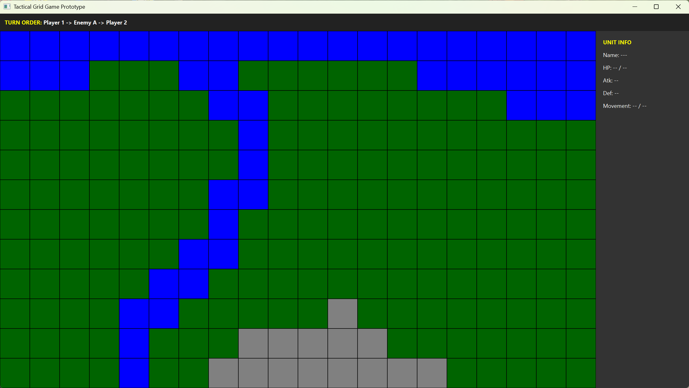

# Tactical Grid-Based Battle System



## Description
My goal is to demonstrate my skills with Java by creating a tactical grid-based game. With Fire Emblem and D&D as my sources of inspiration, I want to focus on grid effects, Player vs. AI combat, a turn-based system, character stats, and victory/defeat conditions.

## Features

### Done
* Map loading from CSV files (`src/main/resources/map1.csv`)
* Terrain types: grass, river, and mountain
* Grid rendering with a 60 FPS game loop
* UI layout with a turn order panel and a unit info sidebar

### Planned
* Characters (Actors) with stats: HP, attack, defense, and movement
* Turn-based system
* Player vs. AI combat
* Grid effects based on terrain
* Victory/Defeat conditions

## Getting Started

### Dependencies
* Java 25 (JDK)
* Maven
* JavaFX 25 (downloaded automatically by Maven)

### Installing
* Install a Java 25 JDK and Maven
* Clone the repository:
```
git clone https://github.com/bryanbeckel/tactical-grid-game.git
cd tactical-grid-game
```

### Executing program
* From the project folder, run:
```
mvn clean javafx:run
```

## Help
* The program must be run from the project folder, since the map is loaded from `./src/main/resources/map1.csv`.
* If `mvn` is not recognized, Maven is not installed or not on your PATH.

## Author
Bryan Beckel
[@BryanBeckel](https://github.com/bryanbeckel)

## Version History
* 0.1
    * Initial Release

## License
This project is licensed under the MIT License - see the [LICENSE](LICENSE) file for details

## Acknowledgments
* [DomPizzie](https://gist.github.com/DomPizzie/7a5ff55ffa9081f2de27c315f5018afc#file-readme-template-md)

## Objects
App: Holds main method for project that starts the game

Grid: Represents the game board.

Tile: Represents a single tile.

TerrainType: Represents the terrain of a tile (grass, river, or mountain).

Actor: Represents a character on the board (in progress).

## Notes
Development notes are kept in [NOTES.md](NOTES.md).
